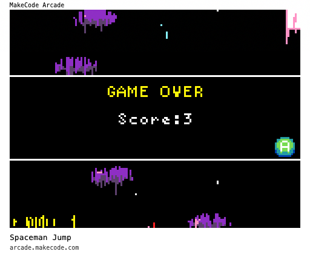

# Space-Jumper
This game was a part of the following event: [2026 MOI] Assemble a Micro:bit based game designer kit and vibe code a game for students.

The game was uploaded to [Sprite Maker Lab](https://sprite-maker-lab.emergent.host/library) and can be played by clicking [makecode link](https://arcade.makecode.com/63957-64316-81217-25456).

The [prompt file](prompt.md) was generated by the Sprite Maker Lab and passed to an LLM to create the [code file](spacejumper.ts).
